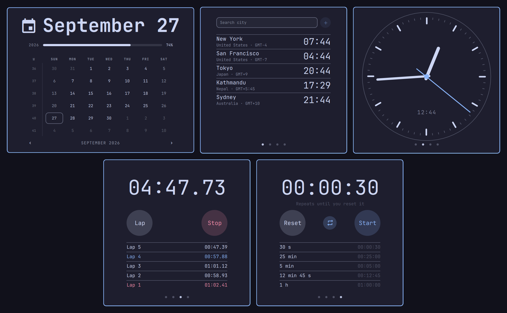

# Apple-like Clock aka Better Calendar



Omarchy's bar clock, split in two:

- **Click the day** (`Saturday`) for the familiar calendar popup, exactly as on the stock clock.
- **Click the time** (`23:54`) for a clock card with four pages, after Apple's Clock app: a
  **world clock**, a minimalist **analogue clock**, a **stopwatch** with lap times, and a
  **countdown timer** that remembers your last five timers.

Both popups appear in the same spot and the bar hands over between them with its normal cross-fade,
so you can click from one half to the other. `Esc` closes either; `Tab` flips from the clock card to
the calendar.

## The clock card

Four dots along the bottom of the card switch pages: **world · clock · stopwatch · timer**. You can
also use `←` / `→` (or `h` / `l`), or swipe sideways with two fingers on a touchpad. The card stays
the same size on every page. It always opens on the clock -- or on the stopwatch or timer while one
is running, so the thing that's counting is what you see first.

### World clock

A search field at the top: type a city and pick from what it finds (the region and country tell the
four Portlands apart), with a click, `↑` / `↓` and `Enter`, or **+**. Each place shows its time,
its country and its offset from GMT (`GMT+5:45`), and `Tomorrow` or `Yesterday` when its date isn't
yours. The newest goes in at the top. Hover a place for the **✕** that removes it. Six fit on the
card, and that's the limit -- remove one to add another.

Summer time is handled: the offsets come from your system's time zone data and are rechecked every
ten minutes while the page is showing.

| Key | |
|-----|--|
| typing | Search (the field has the keys as soon as you arrive on the page) |
| `↑` / `↓`, `Enter` | Choose a result, add it |
| `Esc` | Clear the search; again to hand the keys back to the card |
| `←` / `→` | Switch pages, when the field is empty |

### Clock

A square card with a bare face: hour and minute hands, a slim accent-coloured second hand that
**sweeps** (it moves every frame, it doesn't tick), and a small 24-hour digital time. No numerals,
no chrome. The second hand only animates while the clock page is on screen, so it costs nothing the
rest of the time.

### Stopwatch

The running time at the top (`04:40.95` — minutes, seconds and hundredths), **Lap** and
**Start/Stop** in the middle, and your laps below: the running lap first, then the most recent ones
(as many as fit, up to five). The fastest lap is marked in the accent colour and the slowest in red.
Once stopped, **Lap** becomes **Reset**, which clears the time and the laps.

| Key | |
|-----|--|
| `Space` | Start / Stop |
| `Enter` | Lap, or Reset once stopped |

### Timer

Set the time at the top, then **Start**. No wheels to spin — either:

- **type it**: the digits fill in from the right, the way a microwave's do, so `1` `5` `0` `0` sets
  `00:15:00`. `Backspace` takes a digit back, `x` clears; or
- **scroll** over the hours, minutes or seconds to step that field up or down.

While it's running the line under the time says when it will finish (`Ends 13:24`), and
**Start** becomes **Pause** / **Resume**. **Reset** stops it and puts its time back, ready to run
again.

Below, your **last five timers**: click one to start it straight away. **Press and hold Reset** to
clear them and set the time back to 00:00:00 (it also stops any timer, for a clean slate).

When the time is up you get an Omarchy notification that stays on screen until you dismiss it, and
an alarm sound.

| Key | |
|-----|--|
| `0`–`9`, `Backspace`, `x` | Set the time |
| `Space` | Start / Pause / Resume |
| `Enter` | Reset |

### While something's running

A small card under the bar clock shows the stopwatch or timer counting, in the bar's own font and
size, whenever one is running — the stopwatch if both are. It keeps out of the way while the clock
or calendar popup is open, and clicking it opens the clock card on that page.

The stopwatch and timer keep going with the popup closed, through a shell restart
(`omarchy restart shell`) or a reboot, and while the laptop sleeps: they work from start and end
times rather than counting ticks, so they never drift. A timer that ran out while the lid was shut
goes off as soon as it wakes, and the notification says when it actually finished.

## Install

```bash
omarchy plugin add https://github.com/crazybadger/omarchy-split-clock.git
omarchy plugin enable crazybadger.split-clock
```

Enabling adds it to the bar (it lands after the weather widget). To have it replace the stock clock
in the same slot, edit `~/.config/omarchy/shell.json` and change `{ "id": "omarchy.clock" }` to
`{ "id": "crazybadger.split-clock" }` (your calendar settings, `birthYear` and so on, can stay on the
entry). `omarchy restart shell` after installing or after editing the plugin's code.

## Roll back

```bash
omarchy bar put omarchy.clock --before crazybadger.split-clock
omarchy plugin disable crazybadger.split-clock
```

The stock clock is back where it was.

## Uninstall

Roll back first (above) so the bar isn't left without a clock, then:

```bash
omarchy plugin remove crazybadger.split-clock
```

The saved stopwatch, timer and world clocks are left behind in
`~/.local/state/crazybadger.split-clock/`; delete it too if you like.

## Dependencies

Nothing to build or install beyond what Omarchy already has: its shell, and `python3` (which Omarchy
itself depends on) for the small helper that saves state and runs the world clock search.

**Network:** only the world clock's search goes online. While you type a search, the helper asks
[Open-Meteo's geocoding API](https://open-meteo.com/en/docs/geocoding-api) -- the same free, keyless
service Omarchy's weather panel uses -- for matching places. Nothing else is sent anywhere, and the
clocks themselves work offline once added.

The timer's alarm sound is the standard `alarm-clock-elapsed` sound, from whichever installed sound
theme has it (usually `sound-theme-freedesktop`), played with PipeWire's `pw-play`. Without one the
timer still notifies you, just silently.

## Settings

Set these on the widget's entry in `~/.config/omarchy/shell.json` (they hot-reload):

```json
{ "id": "crazybadger.split-clock", "dayFormat": "ddd d MMM", "timeFormat": "HH:mm:ss", "secondHand": "sweep" }
```

| Key | Default | What |
|-----|---------|------|
| `dayFormat` | `"dddd"` | Label for the day button ([Qt date format](https://doc.qt.io/qt-6/qml-qtqml-qt.html#formatDateTime-method)). Right-click the day to cycle `dddd` / `ddd d MMM` / `d MMMM yyyy` / `dddd d`. |
| `timeFormat` | `"HH:mm"` | Label for the time button. Right-click the time to cycle `HH:mm` / `HH:mm:ss` / `h:mm AP`. |
| `secondHand` | `"sweep"` | `"sweep"` (smooth), `"tick"` (once a second) or `"off"`. |
| `verticalDayFormat`, `verticalTimeFormat` | `"ddd"`, `"HH\n—\nmm"` | Labels when the bar is on the left or right edge. |
| `weekStartDay`, `birthYear`, `lifeExpectancy` | | The calendar's own settings, unchanged from the stock clock. |

Middle-click either half opens Omarchy's timezone picker, as on the stock clock. Changing a format by
right-clicking writes it back to `shell.json`.

## IPC

```bash
omarchy-shell crazybadger.split-clock toggle              # calendar
omarchy-shell crazybadger.split-clock toggleFace          # clock card
omarchy-shell crazybadger.split-clock openPage stopwatch  # clock card on a page: world | clock | stopwatch | timer
omarchy-shell crazybadger.split-clock close               # whichever is open
```

Handy for a keybinding — `openPage timer` straight to the timer, for instance.

## Notes

- Tested on Omarchy 4.0.4 with a top bar (horizontal) and briefly with a left bar (vertical: `Sat`,
  `23`, `—`, `51`), on one and two monitors. With several monitors every bar has its own copy of the
  widget; they share the stopwatch, timer and world clocks, and a finished timer alerts once, not
  once per screen.
- Plugins are unsandboxed code: read it before you install it. It is a handful of small QML files,
  one small Python helper, and the stock calendar.
- **Saved state** -- the stopwatch, the timer and the world clocks -- lives in
  `~/.local/state/crazybadger.split-clock/` (`stopwatch.json`, `timer.json`, `world.json`). The
  shell never reads or writes these itself: `split-clock-helper.py` does, and it refuses rather than
  follows a symlink. Every directory on the way there is opened relative to the one before without
  following links, the directory must be yours and private (it's created `0700`), and files must be
  regular files of yours under 64 KiB. Saves go to a new `0600` file that is then renamed into place
  through the same directory handle, so a link planted at a state path, or swapped in partway
  through, is never written through. The helper runs under a time limit and its output is capped.
  Laps are capped at 999, recent timers at five, world clocks at six.
- 1.1.0 kept its state in `~/.local/state/crazybadger.split-clock.stopwatch.json` and `.timer.json`;
  those are no longer read, so delete them if you have them.
- The accent underline that marks an open popup sits under whichever half you clicked and slides
  across when you hop from one popup to the other. (The bar only draws that mark for a widget's
  primary popup, so this widget silences the bar's mark and draws its own in the same style.)
- Right-clicking a label writes `dayFormat` / `timeFormat` to this widget's entry in `shell.json`,
  as the stock clock does for its format. Nothing else in your configuration is touched.

## Credits

`CalendarPanel.qml` and `Model.js` are Omarchy's own clock panel (MIT, Copyright (c) David Heinemeier
Hansson), copied with only the plugin id changed. `BarWidget.qml` is adapted from Omarchy's clock
widget, and `RunningReadout.qml` borrows the look and placement of Omarchy's `PopupCard`. The clock
card, world clock, stopwatch and timer (`ClockPanel.qml`, `WorldClocks.qml`, `WorldPage.qml`,
`Stopwatch.qml`, `StopwatchPage.qml`, `CountdownTimer.qml`, `TimerPage.qml`, `RoundButton.qml`,
`Helper.qml`, `split-clock-helper.py`) are new. See `LICENSE`.
